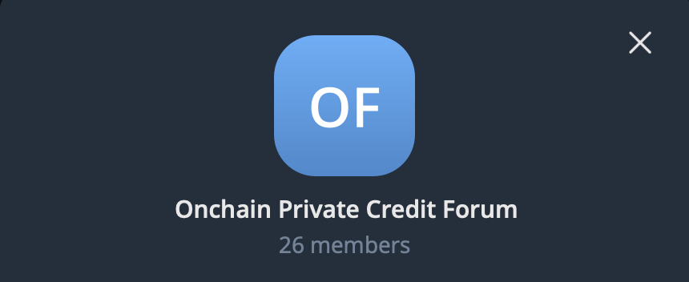

# RWA Tokenization Tooling

A curated catalog of the contracts, standards, test suites and services used to build tokenization protocols for real-world credit and funds: private credit pools, tranched credit, and tokenized treasury and money-market funds.

The catalog is organized by the job to be done. Each entry records what the tool does, under which license it can be reused, its audit status where one is published, and when it was last checked. [Blueprints](blueprints/) show how the pieces combine into a full stack.

The catalog is written for protocol builders, smart contract engineers and auditors who are choosing or reviewing the components of a tokenization stack.

Tokenized stocks and other assets with a liquid market price are out of scope. Credit involves defaults, model-based NAV and gated redemptions, and the catalog is selected accordingly.

## Catalog

| Need | Category |
|---|---|
| Token standard for shares or tranches | [01 Token standards](tools/01-token-standards.md) |
| Deposit and redemption vaults, synchronous or asynchronous | [02 Vault frameworks](tools/02-vault-frameworks.md) |
| Transfer restrictions, identity and KYC gating | [03 Compliance and identity](tools/03-compliance-and-identity.md) |
| Interest accrual, defaults, fees and tranche waterfalls | [04 Pool accounting and waterfalls](tools/04-pool-accounting-and-waterfalls.md) |
| Publishing NAV and loan performance onchain | [05 NAV and oracles](tools/05-nav-and-oracles.md) |
| Redemption queues, gates, lockups and liquidity buffers | [06 Redemptions and liquidity](tools/06-redemptions-and-liquidity.md) |
| Share tokens and pool state across chains | [07 Cross-chain](tools/07-cross-chain.md) |
| Custody, multisig and MPC signing | [08 Custody, wallets and signing](tools/08-custody-wallets-signing.md) |
| Fiat and stablecoin rails for subscriptions and redemptions | [09 Payments and on-ramps](tools/09-payments-and-onramps.md) |
| Deployment, role management, pausing and upgrades | [10 Deployment and admin](tools/10-deployment-and-admin.md) |
| Fuzzing, formal verification and conformance tests | [11 Testing and security](tools/11-testing-and-security.md) |
| Event indexing, investor statements and audit trails | [12 Indexing and reporting](tools/12-indexing-and-reporting.md) |
| Using tokenized credit as collateral and in lending markets | [13 DeFi composability](tools/13-defi-composability.md) |

## Blueprints

Worked examples that map a product type to a choice at each layer of the stack.

- [Tokenized private credit pool](blueprints/tokenized-private-credit-pool.md)

Blueprints for tranched credit and tokenized treasury funds are to be added.

## Entry format

Every entry follows the [template](_templates/tool-entry.md): primary-source link, summary, type, layer, chains, license, audit status where published, date last checked, and notes on when to use the tool and its limitations.

- **Type** states what the tool is: contracts, SDK, service, spec, test suite or framework.
- **Layer** states which part of the stack it serves, such as token, vault, compliance or testing.

## Contributing

Contributions are open to anyone. Every change, including those from maintainers, is made through a pull request; direct pushes to `main` are not used. Inclusion criteria, the entry workflow and the review process are described in [CONTRIBUTING.md](CONTRIBUTING.md).

## Community

The Onchain Private Credit Forum is a Telegram group for private credit builders and LPs. To join, message [@pieakshat](https://t.me/pieakshat) or [@iholdspot](https://t.me/iholdspot) on Telegram.

## Disclaimer

This catalog is not legal or investment advice. License and audit information is accurate as of each entry's **Last checked** date and needs to be verified at the source before a tool is used.

## License

[CC0 1.0](LICENSE). Listed tools keep their own licenses, which each entry records. No code from listed tools is included in this repository.
